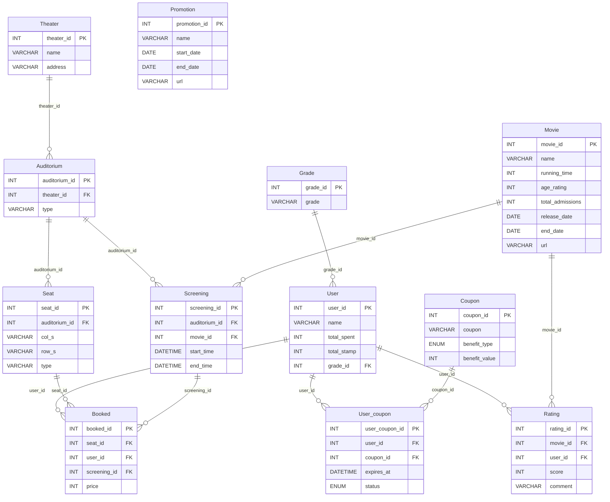

# 영화관 앱 핵심 화면용 DB 설계와 API

롯데시네마 모바일 앱의 화면 4개를 골라, 그 화면을 그리는 데 필요한 데이터를 **MySQL 스키마 → 뷰(View) → Flask API** 순서로 설계하고 구현한 프로젝트입니다.

- 과목: 데이터베이스 (2025-2학기, 가천대학교) · 5인 팀 프로젝트
- 담당: DB 설계 참여, API 개발, Flask 서버 구현
- MySQL 8, Python (Flask, PyMySQL)
- 학습 목적의 과제이며 롯데시네마와 무관합니다. 데이터는 모두 가상입니다.

## 대상 화면

| 화면 | 보여주는 정보 | API |
|---|---|---|
| 메인 | 관객 수 순 영화 랭킹, 사용자 이름, 진행 중 프로모션 | `POST /api/main`, `GET /api/promotions` |
| 상영 시간표 | 영화관·날짜별 상영 회차와 잔여 좌석 | `GET /api/theaters`, `GET /api/movieTime` |
| 좌석 선택 | 선택한 회차 정보, 같은 날 다른 회차, 좌석별 예매 여부 | `GET /api/screenings/<id>`, `GET /api/screenings/<id>/seats` |
| 마이페이지 | 등급, 다음 등급까지 남은 금액, 스탬프, 사용 가능 쿠폰 수 | `POST /api/mypage`, `GET /api/promotions` |

## ERD



테이블은 12개, 외래키 관계는 12개입니다. `Promotion`은 다른 테이블과 외래키로 연결되지 않고 기간 조건으로만 조회합니다.

| 영역 | 테이블 | 설명 |
|---|---|---|
| 사용자 | `User`, `Grade` | 누적 결제액·스탬프, 멤버십 등급 |
| 쿠폰 | `Coupon`, `User_coupon` | 쿠폰 종류(정률·정액·무료 상품)와 사용자별 보유·만료·상태 |
| 영화 | `Movie`, `Rating` | 영화 메타데이터, 사용자 평점(1~10)과 한줄평 |
| 극장 | `Theater`, `Auditorium`, `Seat` | 지점 → 상영관 → 좌석 |
| 상영·예매 | `Screening`, `Booked` | 상영 회차, 좌석 예매 내역과 결제 금액 |
| 프로모션 | `Promotion` | 기간이 있는 이벤트 배너 |

설계에서 신경 쓴 부분은 다음과 같습니다.

- `Booked`에 `UNIQUE (seat_id, screening_id)`를 걸어 같은 회차의 같은 좌석이 중복 예매되지 않게 했습니다.
- `Seat`에 `UNIQUE (auditorium_id, col_s, row_s)`, `Screening`에 `CHECK (start_time < end_time)`, `Rating`에 `CHECK (score BETWEEN 1 AND 10)`을 두었습니다.
- 외래키마다 삭제 정책을 구분했습니다. 예매·평점이 남아 있는 좌석·영화·사용자는 `RESTRICT`, 지점이 사라지면 상영관과 좌석은 `CASCADE`입니다.
- 시간표 조회가 잦은 `Screening(start_time, end_time)`과 조인 키에 인덱스를 추가했습니다.

## 뷰

화면마다 필요한 조인과 집계를 뷰로 묶고, API는 뷰를 조회만 하도록 했습니다.

| 뷰 | 용도 |
|---|---|
| `v_movie_summary` | 영화별 평균 평점과 평점 수 |
| `main` | 메인 화면 영화 목록 (`v_movie_summary` 기반) |
| `v_home_promotions` | 오늘 기준 진행 중인 프로모션 |
| `screening_overview` | 회차 + 영화 + 지점 + 상영관 + 총 좌석 수 + 잔여 좌석 수 |
| `screening_seat` | 회차별 좌석 목록과 예매 여부(`is_booked`) |
| `mypage` | 사용자 등급, 누적 결제액, 스탬프, 유효 쿠폰 수 |
| `Auditorium_seat_count` | 상영관별 좌석 수 |

처음에는 좌석 화면을 하나의 큰 뷰로 만들었지만 회차 정보가 좌석 수만큼 반복되어, 회차 요약(`screening_overview`)과 좌석 상태(`screening_seat`)로 나누었습니다. 마이페이지 뷰도 예매 이력 전체를 담던 것을 화면에 실제로 나오는 등급·금액·스탬프·쿠폰 수만 남겼습니다.

## API

| 메서드 | 경로 | 입력 | 응답 |
|---|---|---|---|
| POST | `/api/main` | `{"user_id": 1}` | `{"movies": [...], "user": {...}}` |
| GET | `/api/promotions` | 없음 | 진행 중 프로모션 배열 |
| GET | `/api/theaters` | 없음 | 영화관 배열 |
| GET | `/api/movieTime` | `?date=YYYY-MM-DD&theater_id=1` (`theater_id` 선택) | 상영 회차 배열 |
| GET | `/api/screenings/<id>` | 경로 변수 | `{"current": {...}, "screenings": [...]}` |
| GET | `/api/screenings/<id>/seats` | 경로 변수 | 좌석 배열 |
| POST | `/api/mypage` | `{"user_id": 1}` | 등급, 다음 등급, 남은 금액 등 |

입력이 잘못되면 400, 대상이 없으면 404를 돌려줍니다. 모든 쿼리는 파라미터 바인딩을 사용합니다.

멤버십 등급은 누적 결제액 26만·52만·84만·124만 원을 경계로 API에서 계산하고, 다음 등급과 남은 금액(`amount_to_next`)을 함께 내려줍니다.

`GET /api/movieTime?date=2025-11-10&theater_id=1` 응답 예시 (일부):

```json
[
  {
    "screening_id": 1,
    "movie_name": "인셉션",
    "theater_name": "롯데시네마 강남",
    "auditorium_type": "일반관",
    "start_time": "Mon, 10 Nov 2025 10:00:00 GMT",
    "end_time": "Mon, 10 Nov 2025 12:30:00 GMT",
    "total_seats": 6,
    "remaining_seats": 3
  }
]
```

## 실행 방법

MySQL 8.0.16 이상이 필요합니다.

```bash
mysql -u root -p < sql/01_schema.sql
mysql -u root -p < sql/02_views.sql
mysql -u root -p < sql/03_seed.sql
```

```bash
pip install -r requirements.txt
```

DB 접속 정보는 환경변수로 넘깁니다. 지정하지 않으면 `localhost:3306`, 사용자 `root`, DB `cinema`를 씁니다.

```bash
DB_PASSWORD=<비밀번호> python app.py
```

```bash
curl "http://127.0.0.1:5000/api/movieTime?date=2025-11-10&theater_id=1"
```

## 폴더 구조

```
├── app.py                # Flask API
├── requirements.txt
└── sql/
    ├── 01_schema.sql     # 테이블·제약조건·인덱스
    ├── 02_views.sql      # 화면별 뷰
    └── 03_seed.sql       # 샘플 데이터
```
